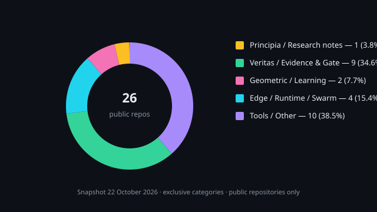
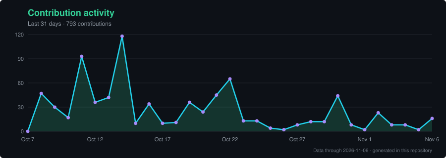
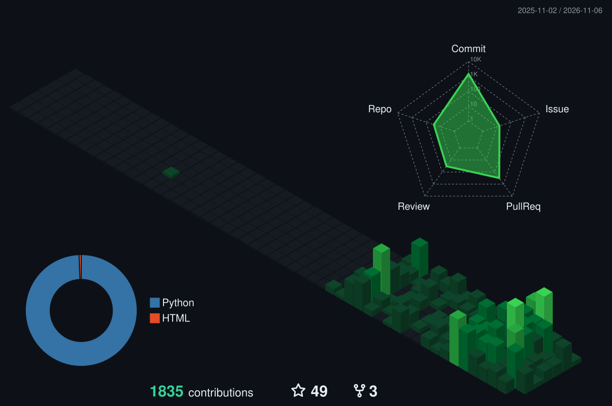
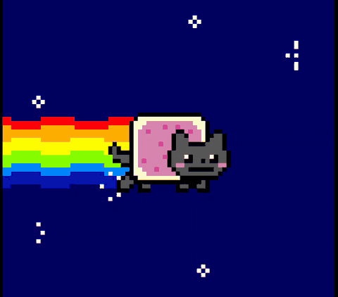

<!-- 
  holland202 GitHub Profile README
  Visual research & engineering portfolio
  Profile identity, Hugging Face, and SML addition 2026-11-06; historical snapshots kept dated
-->

<div align="center">


# Chad Holland

**Machine Builder · Self-Taught AI Researcher (since 2026) · AI-Assisted Software Development**

[](https://github.com/holland202/principia-artificialis)
[](https://holland202.github.io/principia-artificialis/dashboard.html)
[](https://huggingface.co/holland202)
[](https://www.linkedin.com/in/chad-holland-aa364b408)
[](https://orcid.org/0009-0004-1943-0585)

*Vincit Omnia Veritas — Truth Conquers All*

</div>

---

### `whoami`

```text
$ whoami
Chad Holland
Machine Builder | Self-Taught AI Researcher (since February 2026)

I build and investigate experimental AI systems, evidence verification,
offline memory systems, and reproducible research methods.

I direct research and development using several AI models for drafting,
implementation, critique, and testing. AI agreement is not independent
validation. Failed tests, open questions, and limitations remain visible.
```

---

### About me and public research

My background is in industrial machine building. I began exploring AI research in **February 2026** and remain a **self-taught beginner** in the field. I use multiple AI systems under human direction to develop and challenge experimental software. A passing test or AI-generated review is evidence of a bounded check, **not** proof of general correctness or independent security validation.

- **[Hugging Face · @holland202](https://huggingface.co/holland202)** — public model and dataset repositories.
  - [LDE Cross-Substrate Research dataset](https://huggingface.co/datasets/holland202/lde-cross-substrate-research) — experimental results and evidence.
  - [Sovereign Evidence Bench dataset](https://huggingface.co/datasets/holland202/sovereign-evidence-bench) — benchmark artifacts and reproducibility material.
  - [LDE Cross-Substrate Research model repository](https://huggingface.co/holland202/lde-cross-substrate-research) — a research repository, **not a claim of a validated foundation model**.
- **[LinkedIn](https://www.linkedin.com/in/chad-holland-aa364b408)** — professional background and research updates.
- **[ORCID · 0009-0004-1943-0585](https://orcid.org/0009-0004-1943-0585)** — persistent public researcher identifier; not a certification of research findings.
- **[Local Discovery Engine on Codeberg](https://codeberg.org/badatchess/local-discovery-engine)** — project source and experiments.

*Vincit Omnia Veritas — Truth Conquers All.*

---

### GitHub statistics

<p align="center">
  
  
</p>

> Statistics are supplied by third-party services. Contribution totals may differ from public-repository activity depending on GitHub visibility settings and provider methodology.

---

### Programming languages (by byte count)

<p align="center">
  
</p>

**How the percentages are calculated**  
By default the card ranks languages by **byte count** of source files across the user’s non-forked repositories (`size_weight=1`, `count_weight=0`). It is a GitHub metric of code volume, **not** a measure of personal proficiency, and **not** one primary-language vote per repository. Public-instance results reflect public repositories.

---

### Public repository categories  
*(historical snapshot: 22 October 2026 — exclusive assignment, no double-counting; **not a live repository count**)*

<p align="center">
  
</p>

| Category | Repositories | Share |
|----------|--------------|-------|
| Principia / Research notes | 1 | 3.8 % |
| Veritas / Evidence & Gate | 9 | 34.6 % |
| Geometric / Learning | 2 | 7.7 % |
| Edge / Runtime / Swarm | 4 | 15.4 % |
| Tools / Other | 10 | 38.5 % |
| **Total** | **26** | **100 %** |

Representative members:  
- Principia → `principia-artificialis`  
- Veritas → `sovereign-veritas`, `veritas-science`, `veritas-holo`, `eunoia`, `token-veritas`, `veritas-companion`, `vacuity_lint.py`, `evidence-ledger`, `veritas-eval-harness`  
- Geometric → `quasar`, `quasar-v2`  
- Edge / Swarm → `skn-v1-`, `slc-v12-`, `sovereign-evolution`, `sovereign-suite`  
- Tools / Other → remaining public repositories

---

### Contribution activity

<p align="center">
  
</p>

> Generated daily in this repository by [`scripts/activity_graph.py`](scripts/activity_graph.py) from GitHub's public contribution calendar. The image states the date of its last data point.

### Animated green 3D contributions

<p align="center">
  
</p>

> Updated daily with [`yoshi389111/github-profile-3d-contrib`](https://github.com/yoshi389111/github-profile-3d-contrib). Uses a token scoped to this public profile repository; private repositories are not accessed. Updates stop if GitHub reports restricted contribution counts. Generated images live on a separate branch.

---

### Contributions to other projects

Defect reports and pull requests on repositories I don't own. **Historical status snapshot from 2026-10-22; follow links for current state.**

| Project | Contribution | Status | Link |
|---------|--------------|--------|------|
| opena2a-standards/aap-conformance | Showed a verifier that skips the presenter-proof signature check (§4.6) still passed all 43 conformance fixtures | **Fixed by the maintainer** (PR #6, commit `f0d1339`) | [Issue #4](https://github.com/opena2a-standards/aap-conformance/issues/4) |
| opena2a-standards/aap-conformance | Two fixtures pinning the UNKNOWN_KEY checks (follow-up to #4) | Open pull request, not yet reviewed | [PR #8](https://github.com/opena2a-standards/aap-conformance/pull/8) |
| opena2a-org/oasb | Most test files bypass the adapter, so only 69 of 245 tests reach it | Open | [Issue #40](https://github.com/opena2a-org/oasb/issues/40) |
| GenAI-Security-Project/agent-control-standard | `toolCallRequest` has no idempotency binding, so a retry can repeat an external effect | Open | [Issue #200](https://github.com/GenAI-Security-Project/agent-control-standard/issues/200) |
| johnbenac/graphmd | Clarify slash-ref ambiguity for GH-005 repository imports | Closed, not merged | [PR #438](https://github.com/johnbenac/graphmd/pull/438) |

---

### Technology & research methods

**Languages & platforms**  


**AI / edge**  


**Research methods**  


---

### Featured public repositories

| Project | Description | Status | Link |
|---------|-------------|--------|------|
| **Principia Artificialis** | Open research program on the mathematics of artificial thought. Notes with registered predictions; failures retained. | Exploratory · public dashboard live | [Repo](https://github.com/holland202/principia-artificialis) · [Dashboard](https://holland202.github.io/principia-artificialis/dashboard.html) |
| **Sovereign Veritas** | Fail-closed permission gate for AI actions. Decisions packageable, signed, independently re-verifiable. Built and run on a phone. | Experimental · **not production-ready** | [Repo](https://github.com/holland202/sovereign-veritas) |
| **Sovereign Memory Layer (SML)** | Offline evidence-aware memory store with Python, Rust, and TypeScript implementations and differential tests. | Experimental · documented outside adversarial testing · no human code audit | [Repo](https://github.com/holland202/sovereign-memory-layer) · [Testing](https://github.com/holland202/sovereign-memory-layer/blob/main/TESTING.md) |
| **veritas-science** | Executable scientific validation framework for adversarial, preregistered, evidence-first experimentation. | Public research tooling | [Repo](https://github.com/holland202/veritas-science) |
| **veritas-holo** | Falsifiable geometric reasoning substrate: operators, invariants and holonomy, measured before believed. | Public research | [Repo](https://github.com/holland202/veritas-holo) |
| **eunoia** | Evidence-bounded architecture for autonomous intelligence. | Public research · not production-ready | [Repo](https://github.com/holland202/eunoia) |
| **quasar** | Closed-loop learner that generates its own training data. | Public research | [Repo](https://github.com/holland202/quasar) |
| **skn-v1-** | Topology-aware swarm robotics with information geometry and post-quantum trust. | Active research framework · partial implementation | [Repo](https://github.com/holland202/skn-v1-) |
| **slc-v12-** | Hardware-bound, deterministic AI runtime for edge devices featuring thermal-aware manifold inference and Veritas Gate governance. | Research / experimental | [Repo](https://github.com/holland202/slc-v12-) |

---

### Research verification status

| Project | Public status | Independent reproduction | Key public limitations | Evidence |
|---------|---------------|---------------------------|------------------------|----------|
| Principia Artificialis | Exploratory notes program. “Verified” = reference code prints claimed numbers. | Bounded external checks recorded; no broad scientific replication claimed. | AI assistance disclosed; many notes Speculative or Draft. | [Repo](https://github.com/holland202/principia-artificialis) · [METHOD.md](https://github.com/holland202/principia-artificialis/blob/main/METHOD.md) · [Dashboard](https://holland202.github.io/principia-artificialis/dashboard.html) |
| Sovereign Veritas | Experimental fail-closed gate. | Bounded external reproduction of demo + contract recorded. | **Not production-ready · not independently security-validated.** | [Repo](https://github.com/holland202/sovereign-veritas) · [STATUS.md](https://github.com/holland202/sovereign-veritas/blob/main/STATUS.md) · [Issue #79](https://github.com/holland202/sovereign-veritas/issues/79) |
| Sovereign Memory Layer | Offline memory store; Python, Rust, and TypeScript ports, with tests documented in-repo. | One outside preregistered agent-executed adversarial test and outside AI-assisted code review reported; **not a human-run audit**. | **Retrieved values are untrusted; KNOWN does not establish truth.** Real power-loss and hostile-user claims untested. | [README](https://github.com/holland202/sovereign-memory-layer) · [BABEL-001](https://github.com/holland202/sovereign-memory-layer/tree/main/review/babel001_2026-11-03) |
| skn-v1- / slc-v12- | Research frameworks with measured subsystems and explicit design-vs-implemented boundaries. | None claimed beyond repository tests. | Documented in each README. | [skn-v1-](https://github.com/holland202/skn-v1-) · [slc-v12-](https://github.com/holland202/slc-v12-) |

---

### Principia Artificialis research dashboard

**Primary public entry point**

→ [https://holland202.github.io/principia-artificialis/dashboard.html](https://holland202.github.io/principia-artificialis/dashboard.html)

Live status counts, evidence cards, open questions, and contribution entry points. Generated from the public repository and checked in CI.

---

### Hugging Face research artifacts

**[huggingface.co/holland202](https://huggingface.co/holland202)** is the public companion to this GitHub account: [LDE research evidence](https://huggingface.co/datasets/holland202/lde-cross-substrate-research), [Sovereign Evidence Bench](https://huggingface.co/datasets/holland202/sovereign-evidence-bench), and [LDE model repository](https://huggingface.co/holland202/lde-cross-substrate-research). These are experimental artifacts, not endorsements or independently validated model-performance claims.

---

### Collaboration

**Open to ideas beyond my existing projects.** If you have something you want to build, investigate, test, document, or improve together, you're welcome to propose it—even if it has nothing to do with my current repositories.

People from **any background or experience level** are welcome: developers, researchers, engineers, designers, writers, students, independent builders, and curious newcomers. Possibilities include new software, original experiments, reproducibility checks, adversarial review, documentation, accessibility, or a completely different idea you bring.

- **Bring your own proposal.** You do not have to join one of my projects. Explain the goal, what you hope to contribute, and what kind of collaboration would help.
- **Work on an existing project.** Inspect code, challenge hypotheses, reproduce results, report defects, or help with documentation and testing.
- **Set the scope together.** Participation is voluntary and unpaid, at your own pace, with no obligation or fixed schedule. We can decide whether a project is a good fit before starting.

**How to reach out:** For an existing public project, open an issue in its repository. For research-related ideas, [start with Principia Artificialis issues](https://github.com/holland202/principia-artificialis/issues), or use an existing public contact channel to share a proposal.

Helpful starting points: [Research dashboard](https://holland202.github.io/principia-artificialis/dashboard.html) · [Principia Artificialis issues](https://github.com/holland202/principia-artificialis/issues) · [Sovereign Veritas collaboration invitation](https://github.com/holland202/sovereign-veritas/issues/79)

**Critical review, contradictory evidence, and negative results are welcome.** Collaboration proposals are invitations to discuss, not automatic approval to modify a repository or run experiments. This profile does not list or link private repositories.

---

<div align="center">



<sub>nyancat running in Termux on my phone, where most of this work gets built.</sub>

</div>

---

<div align="center">

**Chad Holland** · Machine Builder · Independent AI Researcher · United States  

Language percentages reflect byte-count ranking of public repositories.  
AI assistance in research and development is disclosed in the relevant repositories.

</div>
