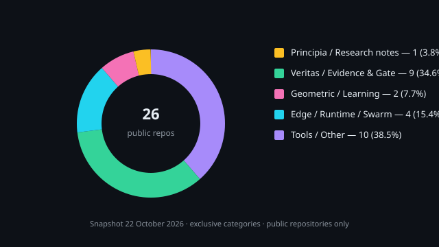

<!-- 
  holland202 GitHub Profile README
  Visual research & engineering portfolio
  Final version with category donut + privacy wording 2026-10-22
-->

<div align="center">


# Chad Holland

**Independent AI Researcher · AI-Assisted Software Developer · Autonomous Systems Research**

[](https://github.com/holland202/principia-artificialis)
[](https://holland202.github.io/principia-artificialis/dashboard.html)

*Vincit Omnia Veritas — Truth Conquers All*

</div>

---

### `whoami`

```text
$ whoami
Chad Holland
Independent AI Researcher | AI-Assisted Software Developer | Autonomous Systems Research

I build and investigate autonomous AI systems, evidence-based software verification,
and reproducible scientific methods.

Work combines AI-assisted development, independent technical evaluation,
formal reasoning, experimental controls, and open scientific collaboration.
```

---

### GitHub statistics

<p align="center">
  
  
</p>

> Statistics are supplied by third-party services. Contribution totals may differ from public-repository activity depending on GitHub visibility settings and provider methodology.

---

### Programming languages (by byte count)

<p align="center">
  
</p>

**How the percentages are calculated**  
By default the card ranks languages by **byte count** of source files across the user’s non-forked repositories (`size_weight=1`, `count_weight=0`). It is a GitHub metric of code volume, **not** a measure of personal proficiency, and **not** one primary-language vote per repository. Public-instance results reflect public repositories.

---

### Public repository categories  
*(snapshot 22 October 2026 — exclusive assignment, no double-counting)*

<p align="center">
  
</p>

| Category | Repositories | Share |
|----------|--------------|-------|
| Principia / Research notes | 1 | 3.8 % |
| Veritas / Evidence & Gate | 9 | 34.6 % |
| Geometric / Learning | 2 | 7.7 % |
| Edge / Runtime / Swarm | 4 | 15.4 % |
| Tools / Other | 10 | 38.5 % |
| **Total** | **26** | **100 %** |

Representative members:  
- Principia → `principia-artificialis`  
- Veritas → `sovereign-veritas`, `veritas-science`, `veritas-holo`, `eunoia`, `token-veritas`, `veritas-companion`, `vacuity_lint.py`, `evidence-ledger`, `veritas-eval-harness`  
- Geometric → `quasar`, `quasar-v2`  
- Edge / Swarm → `skn-v1-`, `slc-v12-`, `sovereign-evolution`, `sovereign-suite`  
- Tools / Other → remaining public repositories

---

### Contribution activity

<p align="center">
  
</p>

> Statistics are supplied by third-party services. Contribution totals may differ from public-repository activity depending on GitHub visibility settings and provider methodology.

---

### Technology & research methods

**Languages & platforms**  


**AI / edge**  


**Research methods**  


---

### Featured public repositories

| Project | Description | Status | Link |
|---------|-------------|--------|------|
| **Principia Artificialis** | Open research program on the mathematics of artificial thought. Notes with registered predictions; failures retained. | Exploratory · public dashboard live | [Repo](https://github.com/holland202/principia-artificialis) · [Dashboard](https://holland202.github.io/principia-artificialis/dashboard.html) |
| **Sovereign Veritas** | Fail-closed permission gate for AI actions. Decisions packageable, signed, independently re-verifiable. Built and run on a phone. | Experimental · **not production-ready** | [Repo](https://github.com/holland202/sovereign-veritas) |
| **veritas-science** | Executable scientific validation framework for adversarial, preregistered, evidence-first experimentation. | Public research tooling | [Repo](https://github.com/holland202/veritas-science) |
| **veritas-holo** | Falsifiable geometric reasoning substrate: operators, invariants and holonomy, measured before believed. | Public research | [Repo](https://github.com/holland202/veritas-holo) |
| **eunoia** | Evidence-bounded architecture for autonomous intelligence. | Public research · not production-ready | [Repo](https://github.com/holland202/eunoia) |
| **quasar** | Closed-loop learner that generates its own training data. | Public research | [Repo](https://github.com/holland202/quasar) |
| **skn-v1-** | Topology-aware swarm robotics with information geometry and post-quantum trust. | Active research framework · partial implementation | [Repo](https://github.com/holland202/skn-v1-) |
| **slc-v12-** | Hardware-bound, deterministic AI runtime for edge devices featuring thermal-aware manifold inference and Veritas Gate governance. | Research / experimental | [Repo](https://github.com/holland202/slc-v12-) |

---

### Research verification status

| Project | Public status | Independent reproduction | Key public limitations | Evidence |
|---------|---------------|---------------------------|------------------------|----------|
| Principia Artificialis | Exploratory notes program. “Verified” = reference code prints claimed numbers. | Bounded external checks recorded; no broad scientific replication claimed. | AI assistance disclosed; many notes Speculative or Draft. | [Repo](https://github.com/holland202/principia-artificialis) · [METHOD.md](https://github.com/holland202/principia-artificialis/blob/main/METHOD.md) · [Dashboard](https://holland202.github.io/principia-artificialis/dashboard.html) |
| Sovereign Veritas | Experimental fail-closed gate. | Bounded external reproduction of demo + contract recorded. | **Not production-ready · not independently security-validated.** | [Repo](https://github.com/holland202/sovereign-veritas) · [STATUS.md](https://github.com/holland202/sovereign-veritas/blob/main/STATUS.md) · [Issue #79](https://github.com/holland202/sovereign-veritas/issues/79) |
| skn-v1- / slc-v12- | Research frameworks with measured subsystems and explicit design-vs-implemented boundaries. | None claimed beyond repository tests. | Documented in each README. | [skn-v1-](https://github.com/holland202/skn-v1-) · [slc-v12-](https://github.com/holland202/slc-v12-) |

---

### Principia Artificialis research dashboard

**Primary public entry point**

→ [https://holland202.github.io/principia-artificialis/dashboard.html](https://holland202.github.io/principia-artificialis/dashboard.html)

Live status counts, evidence cards, open questions, and contribution entry points. Generated from the public repository and checked in CI.

---

### Collaboration

Developers, researchers, engineers and independent contributors are invited to inspect public work, challenge hypotheses, report defects, and participate in reproducible research (voluntary, unpaid).

- [Research dashboard](https://holland202.github.io/principia-artificialis/dashboard.html)  
- [principia-artificialis issues](https://github.com/holland202/principia-artificialis/issues)  
- [Sovereign Veritas collaboration invitation](https://github.com/holland202/sovereign-veritas/issues/79)

Critical review and negative results are valued.  
This profile does not list or link private repositories.

---

<div align="center">

**Chad Holland** · Independent Researcher · Oklahoma, United States  

Language percentages reflect byte-count ranking of public repositories.  
AI assistance in research and development is disclosed in the relevant repositories.

</div>
